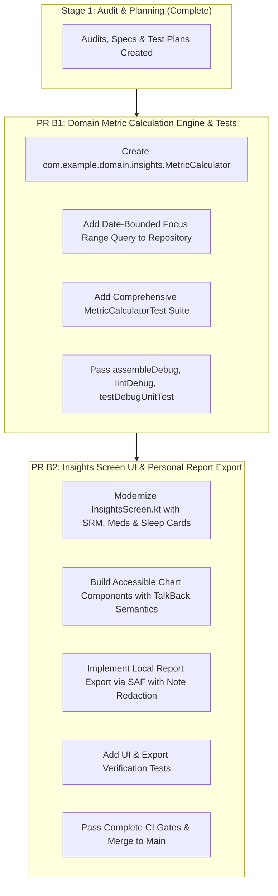

# Phase B: Correction Roadmap & Implementation Strategy

**Roadmap Date:** November 9, 2026  
**Audited Target:** `com.jayasuriya.rhythm`  
**Current Phase:** Phase B — Insights & Meaningful Tracking (Stage 1 Audit $\to$ Stage 2 Plan)  
**Authority:** Principal Android Engineer & Product Architect

---

## 1. Stage 1 Audit Summary & Transition Gate

Stage 1 has comprehensively audited Rhythm's data storage, metric calculations, privacy boundaries, and analytics presentation.

### Audit Deliverables Completed:
1. [**`design/audits/PHASE_B_DATA_INVENTORY.md`**](file:///e:/Programming/personal%20app/Rhythm/design/audits/PHASE_B_DATA_INVENTORY.md): Full inventory of 20 Room entities, DAOs, flows, Health Connect vitals, and query limits.
2. [**`design/audits/PHASE_B_METRIC_SPECIFICATION.md`**](file:///e:/Programming/personal%20app/Rhythm/design/audits/PHASE_B_METRIC_SPECIFICATION.md): Strict mathematical definitions for Sleep Duration & Consistency (Standard Deviation), Social Rhythm Metric (SRM-5 hit window), Medication Adherence, Focus breakdown, and missing data (`"--"` / `null` vs `0`).
3. [**`design/audits/PHASE_B_INSIGHTS_PROPOSAL.md`**](file:///e:/Programming/personal%20app/Rhythm/design/audits/PHASE_B_INSIGHTS_PROPOSAL.md): Redesign proposal for `InsightsScreen.kt` with accessible visualizations, multi-period trends, and clinical/personal report exports.
4. [**`design/audits/PHASE_B_PRIVACY_REVIEW.md`**](file:///e:/Programming/personal%20app/Rhythm/design/audits/PHASE_B_PRIVACY_REVIEW.md): Verification of 100% air-gapped zero-network architecture, SQLCipher at rest, and export redaction safeguards.
5. [**`design/audits/PHASE_B_TEST_PLAN.md`**](file:///e:/Programming/personal%20app/Rhythm/design/audits/PHASE_B_TEST_PLAN.md): Test matrix covering mathematical precision, DST transitions, leap years, and missing data assertions.

---

## 2. Stage 2 Implementation Strategy (Focused PRs)

In strict adherence to project workflow rules, Stage 2 implementation will be split into **two focused, independently verifiable pull requests**:

---

### PR B1: Domain Metric Calculation Engine & Repository Range Queries
- **Objective:** Create a pure, rock-solid Kotlin domain calculation engine with comprehensive unit test coverage before touching the UI.
- **Scope & Files to Modify/Create:**
  - `app/src/main/java/com/example/domain/insights/MetricCalculator.kt`: Pure domain object calculating:
    - Sleep average duration, bedtime circular standard deviation, and consistency tier.
    - SRM-5 daily regularity index, anchor hit windows (±45 min), and weekly regularity score.
    - Medication scheduled dose counts, intake classification (`TAKEN_ON_TIME`, `TAKEN_DELAYED`, `SKIPPED`, `UNRECORDED`), and adherence rate.
    - Focus session duration aggregations and category percentages.
    - Mood & energy rolling averages and trajectories.
    - Strict missing-data separation (`null` / `"--"`, never `0`).
  - `app/src/main/java/com/example/data/repository/AppRepository.kt` & `StudyDao`:
    - Add `getStudySessionsBetweenDates(startDate: String, endDate: String): Flow<List<StudySessionEntity>>` to prevent clipping beyond 20 sessions.
  - `app/src/test/java/com/example/domain/insights/MetricCalculatorTest.kt`:
    - Comprehensive unit tests covering all 18 test cases specified in `PHASE_B_TEST_PLAN.md`.
- **Quality Gates:**
  - `./gradlew :app:assembleDebug :app:lintDebug --stacktrace`
  - `./gradlew :app:testDebugUnitTest -ProbolectricOffline=false --stacktrace`

---

### PR B2: Insights Screen Modernization & Personal Summary Export
- **Objective:** Surface the validated metrics in a calm, accessible, and intuitive UI, and replace the mock export card with functional on-device report generation.
- **Scope & Files to Modify/Create:**
  - `app/src/main/java/com/example/ui/screens/insights/InsightsScreen.kt`:
    - Integrate `MetricCalculator` via `MainViewModel` or dedicated `InsightsViewModel`.
    - Add **Sleep Consistency Card** with duration bars and variation label.
    - Add **Social Rhythm Metric (SRM-5) Regularity Card** with 5-anchor grid and hit indicators.
    - Add **Medication Adherence Card** with on-time vs delayed vs unrecorded dose progress.
    - Add **Mood & Energy Trajectory Card** with 7-day sparkline and correlation observation.
    - Add **Focus & Learning Card** with category distribution.
    - Full TalkBack accessibility semantics and 48dp touch targets on interactive chart points.
  - `app/src/main/java/com/example/util/ReportExportManager.kt`:
    - Generates structured Markdown and Plain Text personal/clinical summaries.
    - Implements dual-level privacy redaction (toggle to exclude freeform text notes).
    - Writes directly to user-selected SAF URI (`ACTION_CREATE_DOCUMENT`).
  - `app/src/test/java/com/example/ui/screens/insights/InsightsScreenTest.kt` & `ReportExportTest.kt`:
    - Robolectric tests verifying UI state rendering and export file structure.
- **Quality Gates:**
  - `./gradlew :app:assembleDebug :app:lintDebug --stacktrace`
  - `./gradlew :app:testDebugUnitTest -ProbolectricOffline=false --stacktrace`

---

## 3. Ready for Approval

Stage 1 is complete. No application source code has been modified during Stage 1. Once you approve this roadmap and implementation strategy, we will create the feature branch for **PR B1** and begin implementation.
